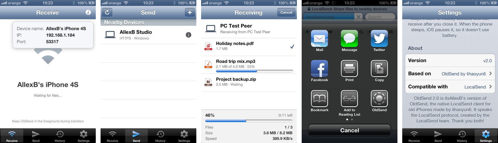

#

<h1 align="center">OldSend 2.1.1</h1>
<h3 align="center">A native LocalSend-compatible client for jailbroken iOS 6 devices</h3>

OldSend 2.1.1 is my version of [OldSend by lihaoyun6](https://github.com/lihaoyun6/OldSend), the native [LocalSend](https://localsend.org) client for old iPhones, made for iOS 6 on Retina iPhones (tested on an iPhone 4S, iOS 6.1.3). Send files, photos, videos, links and text between an old iPhone and any device running LocalSend.

## Features

- **Works with LocalSend everywhere**: protocol v2.2 (multicast discovery, register, prepare-upload, upload and cancel) over TLS 1.2, with bundled mbedTLS 2.28.8. Sending to LocalSend on desktop works again: LocalSend 1.17 answers with `Transfer-Encoding: chunked`, which the original client couldn't read.
- **Live transfer screen**, like LocalSend's: every file with its own progress and state (waiting, sending, done, skipped, failed), plus overall progress, files, size, speed and time left, with Cancel while it runs. Files the receiver leaves out are skipped instead of failing the whole send.
- **OldSend in the share sheet of every app.** A small MobileSubstrate add-on (`share/`) puts an OldSend button into the iOS 6 share sheet (Safari, Photos and any app using `UIActivityViewController`); links, text, photos, videos and files shared with it open in OldSend's Send tab, ready to send. OldSend also appears under "Open in…" for any file.
- **Run in Background** (Settings, off by default): a background service (the same binary, started by launchd at boot, `client/OSDaemon.m`) keeps the phone discoverable and able to receive with OldSend closed. Incoming requests show a notification banner (and "Received …" when files arrive), kept in Notification Center until the request is answered; tapping it opens OldSend with the Accept / Decline prompt and the live transfer screen. OldSend has its own entry in Settings > Notifications, like any app. The app and the service hand the port to each other automatically, the service follows Wi-Fi network changes, and it keeps the phone awake only while files are coming in. While the phone sleeps, iOS pauses it like any app, so it costs no battery while waiting.
- **Send anything**: photos, videos, text, the clipboard, links and any file, with a built-in filesystem browser. Tapping a device with nothing chosen opens the choices.
- **A media picker that feels like Photos**: it opens at the newest. Tap a thumbnail to select it; hold one for a moment, or slide sideways from it, then drag to select or deselect a range, with the grid scrolling at the top and bottom edges (faster closer to the edge). Any other move scrolls, also starting on a thumbnail. Same feel and tuning as [Photos Select](https://github.com/itsAllexB/PhotosSelect-iOS6).
- **Receive** into History, with **Save to Photos** in Settings: on, received photos and videos are moved into Photos (one copy, like LocalSend), with the image data as it arrived (not decoded or re-encoded; the library adds a small header to JPEGs); off, they stay in History. This happens at once also with OldSend closed: the background service saves them too, once OldSend has been allowed to use Photos. The transfer screen and the Receive page show "Saving to Photos… 3 of 15", and the app stays usable meanwhile. Quick Save accepts incoming files without asking. One failed file costs only that file: the others still arrive.
- **Save to Music** (Settings, on by default): received songs that iOS 6 plays natively (MP3, AAC and Apple Lossless in `.m4a`, `.m4b` audiobooks, `.aac`, WAV, AIFF, CAF) are moved into the Music app, with their tags and artwork, and show up under Songs, Artists and Albums. WAV, AIFF or CAF that iOS 6 won't play, such as 24-bit 96 kHz, go in as Apple Lossless (see Known limitations). OldSend uses the iPhone's own music library code (MusicLibrary.framework's importer, the one the iTunes Store uses for downloads), so the library database stays consistent; if anything fails, the song stays in History and OldSend says so. FLAC, Ogg, Opus and other formats iOS 6 can't play stay in History the same way. The background service adds songs too. **If you sync music with iTunes, read the iTunes sync note under Known limitations first: iTunes can delete songs added this way.**
- **History opens what you received**: songs and videos play in iOS's own full-screen player (Done, AirPlay and the full-screen toggle work as in iOS's apps), and photos, PDFs, documents and text open in Quick Look, like Mail's attachments, with "Open in…" in the share button. Files neither can show get the file info as before.
- **Network info** on the Receive page: device name, IP addresses and port.
- **Keeps working after switching apps**: OldSend reopens the sockets iOS reclaims from suspended apps, asks for a few minutes of background time so transfers can finish, and posts a notification for incoming requests while in the background.
- **Robust receiving**: waits out Wi-Fi stalls of up to a minute and recovers when a sender disappears.
- **Sharp on Retina screens**: every interface image has an @2x version, file-type icons are a vector-drawn set (`tools/make_file_icons.py`), there are launch images, and the app icons follow Apple's iOS 6 template (`tools/make_app_icons.py`).
- **Native Objective-C / UIKit**, with no dependency on Flutter, Electron or web runtimes. English, Romanian and Simplified Chinese interface.

> Requires a jailbroken iOS 6 device (armv7) with MobileSubstrate; the package installs on iOS 6.x only. OldSend is installed as a system app under `/Applications`.

## Known limitations and to do

- **iTunes sync can delete songs added by Save to Music.** Songs OldSend adds to Music exist only on the iPhone; they aren't in the computer's iTunes library. If the iPhone syncs music with iTunes (Sync Music on, rather than "Manually manage music and videos"), iTunes makes the phone's music match its own library at the next sync and removes songs it doesn't know, these included. Save to Music moves the file (it doesn't keep a copy in History), so a removed song is gone from the phone. If you sync music with iTunes: keep the original on the sending computer (or add it to iTunes too), or turn Save to Music off in Settings so received songs stay in History, which iTunes sync doesn't touch. In the app, the "i" next to Save to Music says this in short.
- **WAV above 48 kHz is resampled.** iOS 6 refuses some PCM files (a 24-bit 96 kHz WAV, for one), so OldSend converts those to Apple Lossless: every sample is kept at up to 24 bits, but anything above 48 kHz becomes 48 kHz, the most the iPhone's audio hardware puts out. The original WAV isn't kept. Tags inside such a WAV are lost; the file name becomes the title.
- Songs are added as songs (`.m4b` as audiobooks); OldSend doesn't create playlists, and ringtones (`.m4r`) stay in History.
- iOS 6 can't play FLAC, Ogg Vorbis or Opus, so those stay in History and Quick Look can't preview them.
- **The iPhone 4S's Wi-Fi link can collapse by itself.** Seen on an iPhone 4S with a strong signal: raw throughput falls to about 5-10 KB/s and pings take 1-2 s or get lost, also outside OldSend (`ssh` over Wi-Fi was as slow), while the router answers in 1 ms. Bluetooth isn't the cause. Turning Wi-Fi off and on brought it back to about 1.4 MB/s, for a few minutes each time. On a desktop this looks like a transfer stuck at 0%; cancelling it there or on the phone is what LocalSend reports as `hyper::Error(IncompleteMessage)`. Cause not found yet; OldSend now waits out stalls of up to a minute, and a file that still fails costs only that file.
- **Respring once after installing or updating.** iOS 6 only gives a Notification Center section to system apps (OldSend is installed in `/Applications`) tagged `SBInternalAppTag`, and that tag also hides the app's icon. OldSend doesn't use the tag: its add-on in SpringBoard (`share/`) adds OldSend to that one list (`-[SBPushStore allLocalNotificationEnabledBundleIDs]`). Until SpringBoard has restarted with the add-on, the background service's notifications don't appear.
- **Music can show only some of several new songs until it's relaunched.** After receiving several songs with Save to Music, Music listed only 1 of 3 until it was closed and reopened.
- If SpringBoard restarts while a request is waiting, its "Tap to accept" notification stays in Notification Center after you answer; clear it by hand.

## Installation

Add the **ios-legacy** source to Cydia, `https://itsallexb.github.io/ios-legacy/`, and install OldSend (package `com.itsallexb.oldsend`; it replaces lihaoyun6's `com.lihaoyun6.oldsend` if that is installed). Or download the `.deb` from this repository's releases and install it with `dpkg -i`.

Install the `.deb`, not an IPA: OldSend keeps its TLS identity in `/var/mobile/Library/OldSend`, which a sandboxed IPA install cannot create.

## Build

GitHub Actions checks the strings (`tools/check_strings.py`: every language must have the same keys and take the same format arguments, since a wrong one crashes the app) and builds the `.deb` on every push (`.github/workflows/build-ios6.yml`), with `ci/build-ios6.sh`: Theos' iOS toolchain for Linux, the iOS 9.3 SDK (the newest with armv7) and Procursus `ldid`. The script compiles the app, `MediaPicker.dylib`, the share add-on and packages them with the launchd job, using `dpkg-deb` so that iOS 6's dpkg accepts the archive.

Upstream's `build.sh` (macOS, iPhoneOS 3.1.3 SDK, armv6) is still in the repository but doesn't build this version, which uses iOS 6 APIs throughout.

`tools/localsend_send.py` sends files to a phone over the LocalSend protocol from a computer, for testing without the LocalSend app.

## Credits

- **[lihaoyun6](https://github.com/lihaoyun6)** made [OldSend](https://github.com/lihaoyun6/OldSend), which this is built on: the native UI, the LocalSend implementation on mbedTLS, the media picker and the file browser. Thank you!
- **The [LocalSend](https://localsend.org) team** created LocalSend and its open protocol, which is what lets an iPhone from 2011 talk to today's phones and computers. Thank you!
- OldSend 2.0 and 2.1 changes and the new app icon by [itsAllexB](https://github.com/itsAllexB). The share-sheet button uses the shapes of LocalSend's logo. The credits are in the app too, under Settings > About.

## Third-party

- [mbedTLS](https://github.com/Mbed-TLS/mbedtls) — Apache-2.0
- [cJSON](https://github.com/DaveGamble/cJSON) — MIT
- Icons drawn from [Material Icons](https://github.com/google/material-design-icons) — Apache-2.0

OldSend is licensed under Apache-2.0, like the original; files changed from upstream are listed in the git history.

> OldSend is an independent project and is not affiliated with the LocalSend project.
